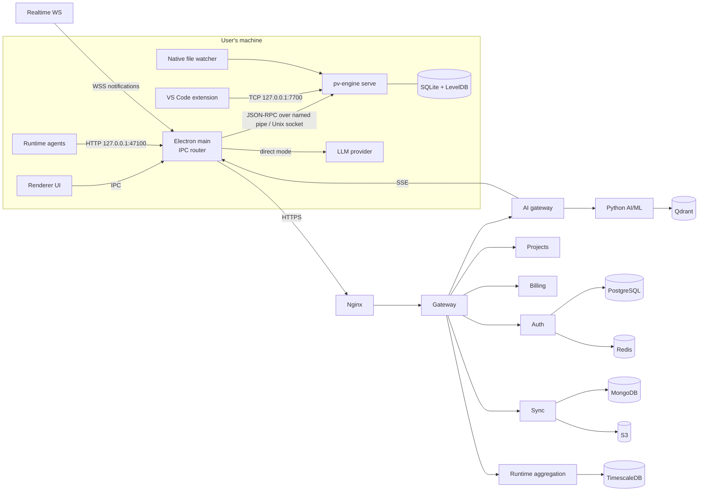

# Architecture overview

One page that explains the entire system. Updated on 2026-09-26 for the new client-server architecture ([`incoming/`](incoming/new-architecture.md), comparison in [`incoming/diff.md`](incoming/diff.md)).

## Style

- **Desktop-first.** Parsing, graphs, impact, health, simulation and runtime visualization run on the user's machine in the native engine. The desktop works offline except for cloud AI, team sync and billing.
- **Code never leaves the machine.** The server only sees graph metadata (names, paths, spans, metrics), runtime aggregates and AI context snippets, and only when the user asks for a team or AI feature.
- **Lean server.** Identity, teams, billing, the AI proxy, optional sync and team runtime dashboards. Scaling is a coordination and AI-gateway problem, not a parsing one.
- Modular monolith per process; auto-discovered modules (engine modules, desktop handlers and features, renderers, server routes).

## Parts

**Desktop client (user's machine)**
- UI (Electron renderer, React): 2D view (React Flow + D3; Cytoscape as Classic), 3D view (React Three Fiber; 3d-force-graph as Classic), AI chat, simulation, runtime visualizer, health dashboard.
- Electron main process: the IPC server and message router between the UI and the engine; files, secrets, the runtime hub (`127.0.0.1:47100`), the cloud client.
- `pv-engine` (C++20): parsing (tree-sitter, plugin loader), analysis (dependencies, impact, health, complexity), graph (layered model, 2D/3D layouts, health propagation, abstraction levels), runtime (ingestion, module tracer, error mapping, execution visualization). Runs as `pv-engine serve`: the desktop connects over a **named pipe** (Windows) / **Unix socket** (macOS, Linux), the VS Code extension over **TCP `127.0.0.1:7700`**.
- Local cache: SQLite (project metadata, extraction index) + LevelDB (graph blobs, layout cache). Native file watcher.
- Runtime agents (Python, Node, any OpenTelemetry app) inside the user's application.

**Server (Node.js / TypeScript)** — four instances for 200 users (R13): A. API gateway + auth & teams (Nginx, gateway, realtime WebSocket, auth, projects/teams, billing, licensing, SSO, audit, feedback) · B. AI gateway + sync (ai-gateway with SSE relay, ml-gateway, sync) · C. Python AI/ML service · D. runtime aggregation with TimescaleDB.

**Python AI/ML service (FastAPI)** — LLM gateway with provider fallback, embeddings, vector search (Qdrant; Pinecone adapter), ML models (failure prediction, bottlenecks, health forecasting, anomaly detection, recommendations).

## Diagram

