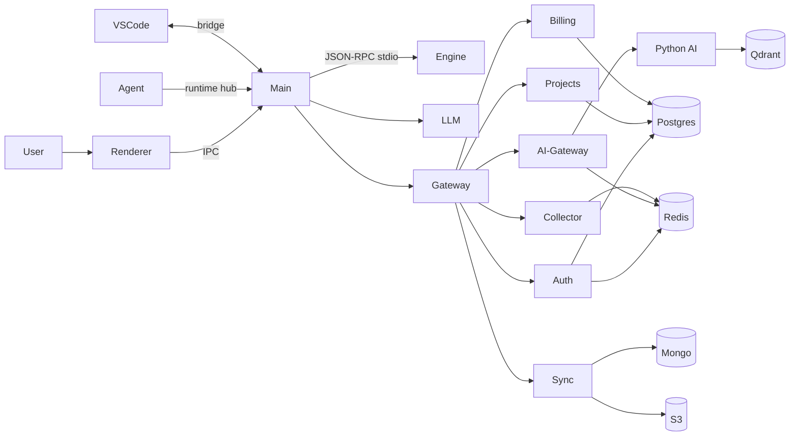

# Architecture overview

One page that explains the entire system. [ARCH-DEPENDENT]

## Style

- Local-first desktop client + optional cloud services.
- Modular monolith per process.
- Auto-discovered plug-in modules (engine modules, desktop handlers and features, server routes).

## Processes

- `pv-engine` — C++20 core engine (parsing, graph, analysis), a child process of the desktop app.
- Desktop main — Electron main process (windows, engine process, files, network, secrets, runtime hub, AI calls).
- Desktop renderer — React UI, no Node access.
- Runtime agents — Python and Node libraries inside the user's application.
- VS Code extension — editor integration through the local bridge.
- Cloud services — Node.js/TypeScript services behind the gateway (optional).
- Python AI service — `pv_ai`, FastAPI (Phase 4+, optional cloud mode).

## Diagram

